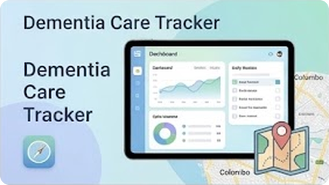
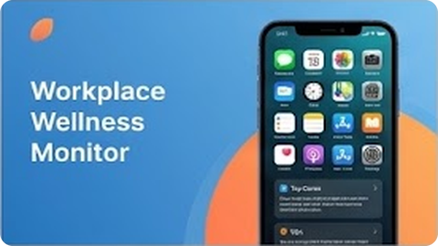
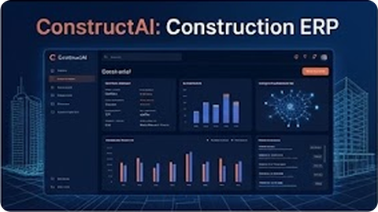

<!-- ============================================================
     Methu(Jerome) Perera | GitHub profile README
     Images load from the /assets folder in this same repo.
     ============================================================ -->

<!-- HERO -->

  

# Methu(Jerome) Perera Here! 👋

### *"Software Developer – With Great Power Comes Great Responsibility"*

 

## 👋 A little about me

Hi, I'm Methu. I'm a software developer from Sri Lanka who loves turning messy real-world problems into clean, working software. Most of what I build sits where tech meets everyday life: health, wellbeing, construction and law.

When I'm not coding, I'm usually reading up on AI, brushing up on data structures, or figuring out how to make my next project a little better than the last one.

- 🔭 **Working on:** Pocket Lawyer
- 🌱 **Learning:** AI and Data Structures
- 👯 **Open to collaborating on:** AI developments and security
- 💬 **Ask me about:** PHP, which I'm working with right now
- ⚡ **Fun fact:** JavaScript was created in just 10 days by Brendan Eich in 1995

## 🛠️ What I work with

**Languages**

**Frontend**

**Backend & Databases**

**Tools**

## 🚀 Things I've built

A few projects I'm proud of. Click through, have a look around, and feel free to leave a ⭐.

<table>
  <tr>
    <td width="260" align="center">
      
    </td>
    <td>
      <h3><a href="https://github.com/JEROME-2005/Dementia-Tracker">Dementia Risk Prediction System</a></h3>
      An AI-powered web app that gives a non-invasive estimate of dementia risk from lifestyle and demographic factors. Built to make early awareness easier for everyone.
        
      <code>React</code> <code>Node.js</code> <code>Python</code> <code>Jupyter Notebook</code>
    </td>
  </tr>
  <tr>
    <td width="260" align="center">
      
    </td>
    <td>
      <h3><a href="https://github.com/JEROME-2005/Employee-Stress-Tracker">Employee Stress Tracker</a></h3>
      A desktop app that helps monitor stress levels and look after employee wellbeing, built with Python and Tkinter.
        
      <code>Python</code> <code>Tkinter</code>
    </td>
  </tr>
  <tr>
    <td width="260" align="center">
      
    </td>
    <td>
      <h3><a href="https://github.com/JEROME-2005/ERP-Construction-Web-Application">ConstructAI ERP System</a></h3>
      A full ERP system made for construction project management, covering the day-to-day running of a project in one place. Built with Spring Boot and React.
        
      <code>Java</code> <code>Spring Boot</code> <code>React</code>
    </td>
  </tr>
</table>

## 📊 My GitHub in numbers

## 🤝 Let's talk

Got an idea, a project, or just want to say hi? I'd love to hear from you.

 

Thanks for stopping by, and happy coding! 💻

